# Screenshots

A visual tour of Mitch‑Dojo, captured from a running instance in light theme.

## Dashboard & analytics

### Dashboard

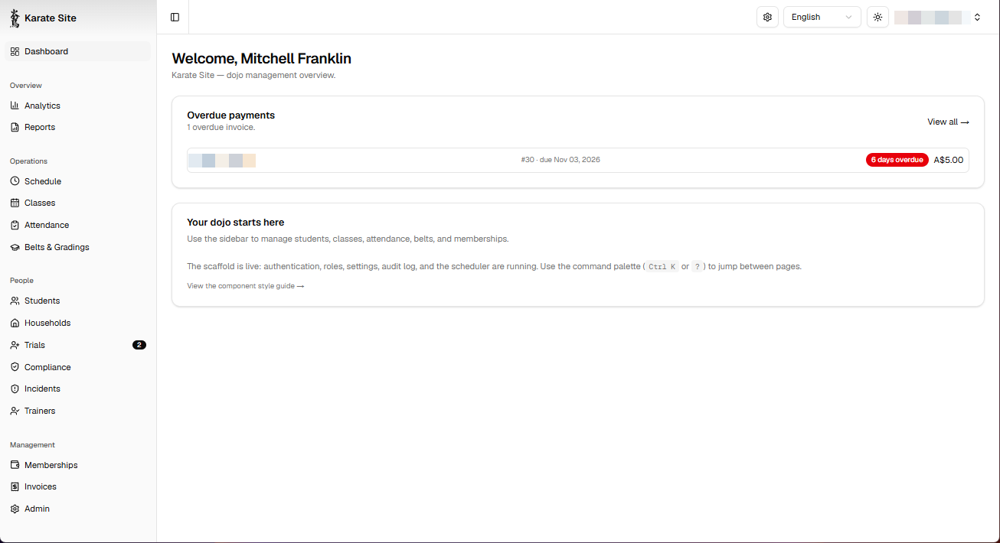

### Analytics

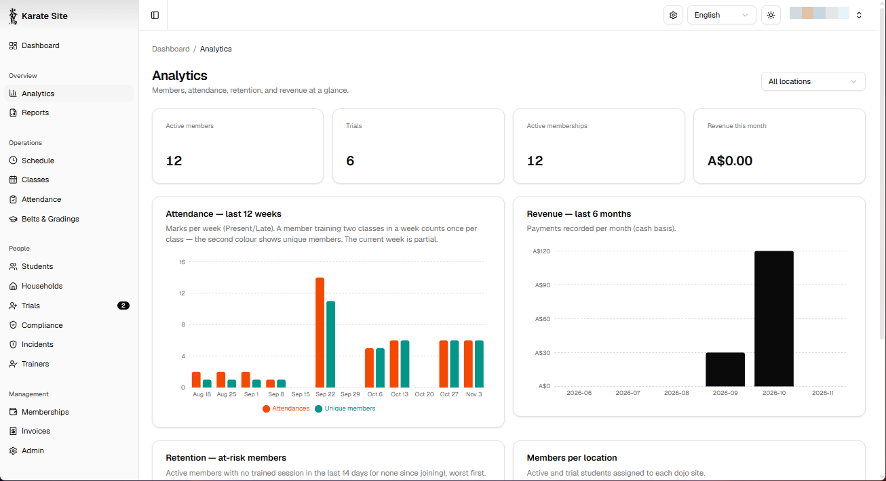

## Students & schedule

### Students

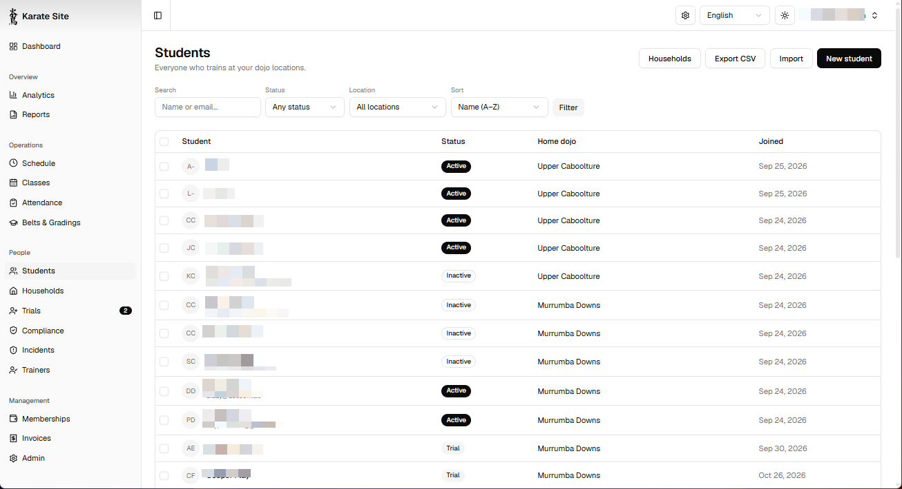

### Student record

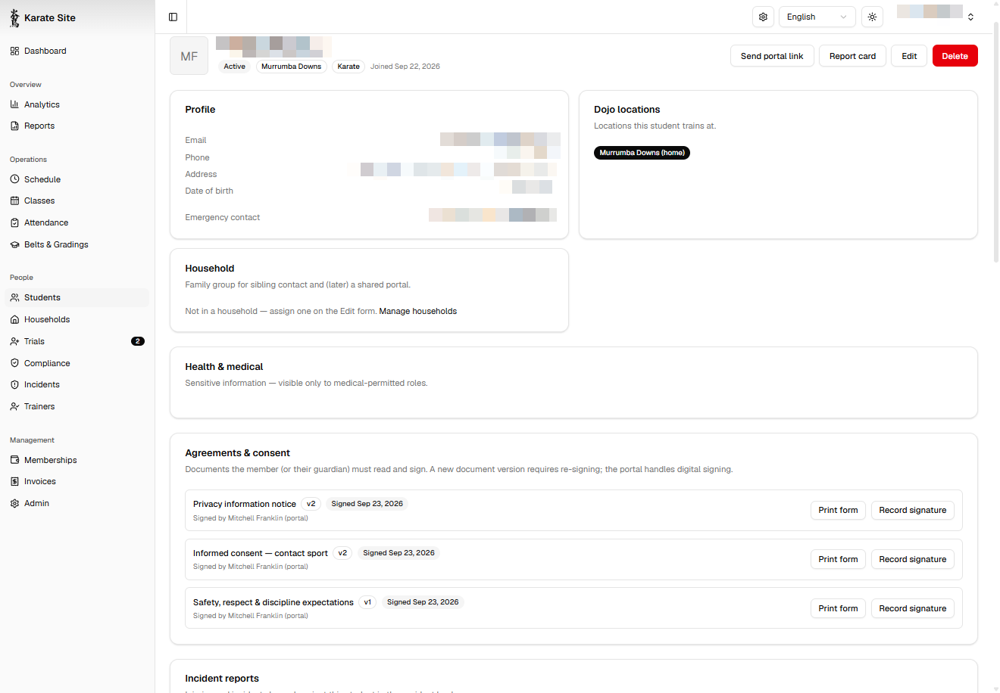

### Weekly timetable

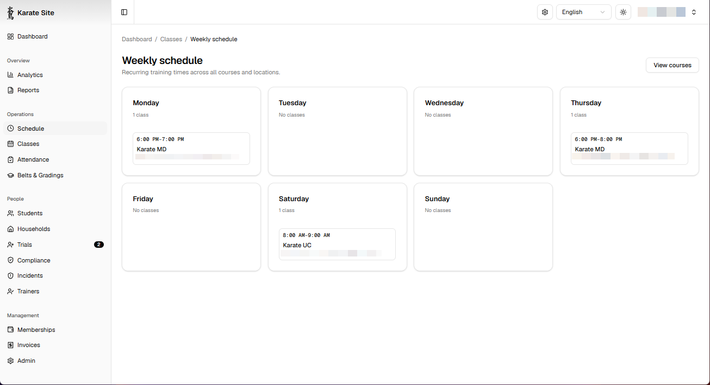

## Attendance & belts

### Attendance browser

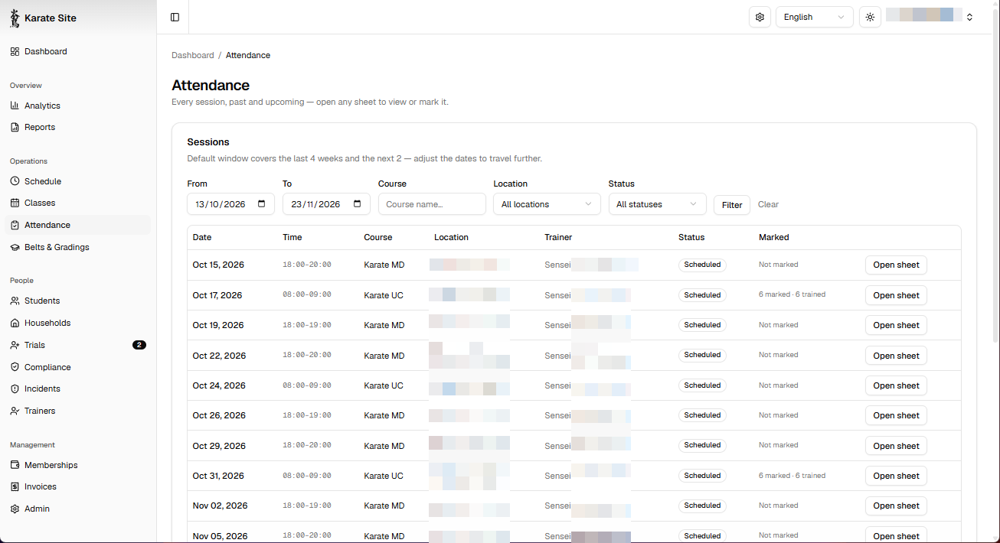

### Attendance sheet

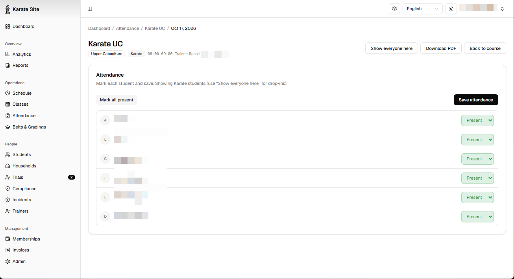

### Belt ladder

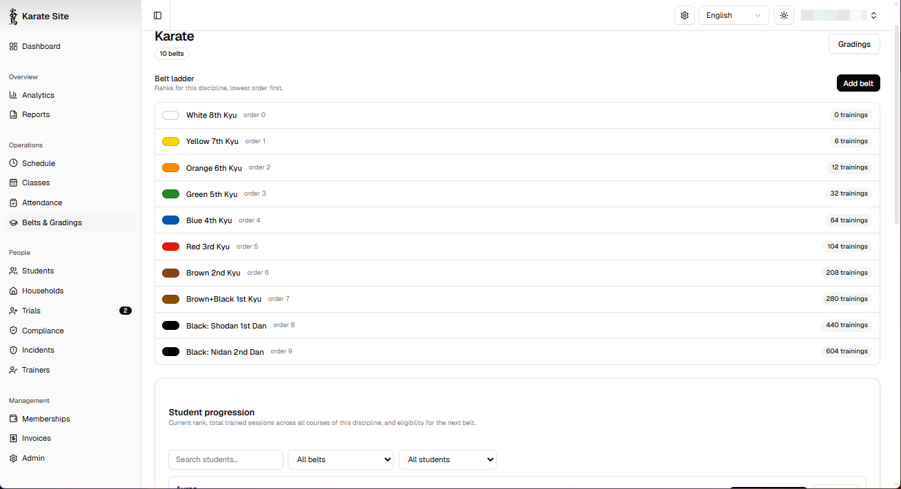

## Memberships & trials

### Memberships

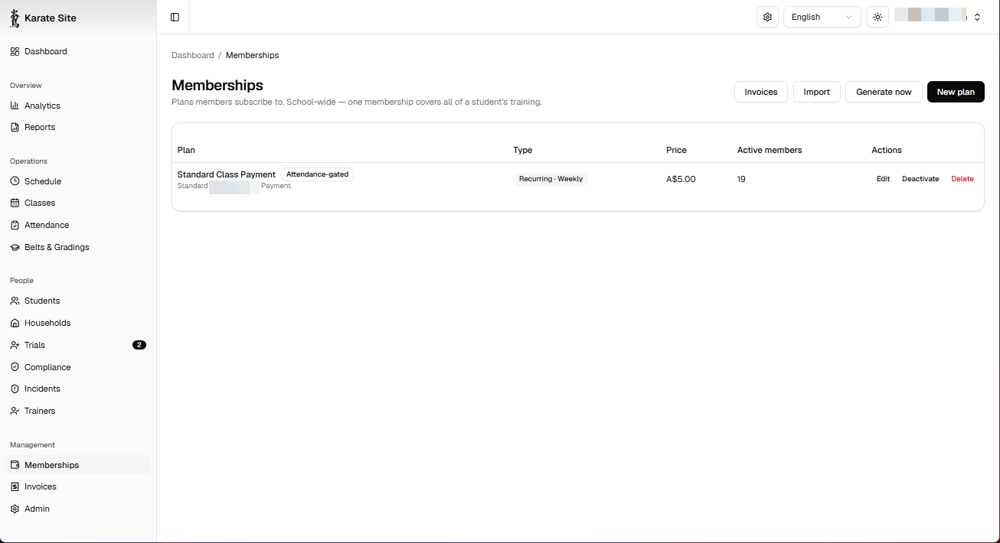

### Trial pipeline

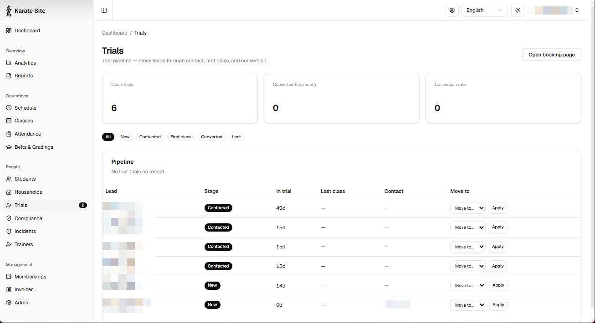

### Public booking page

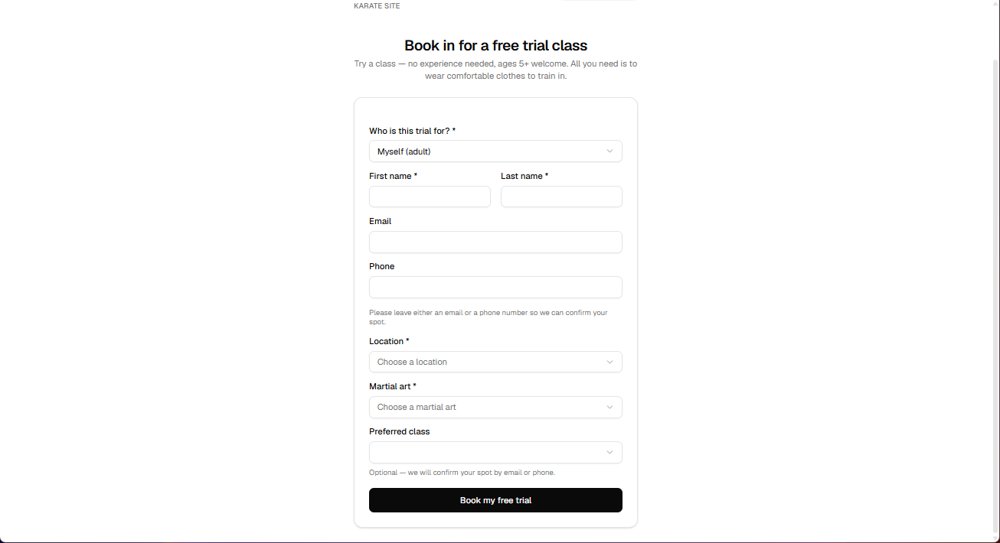

## Portal & admin

### Member portal

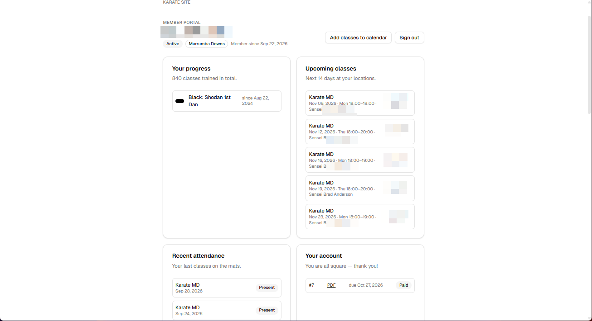

### Admin general

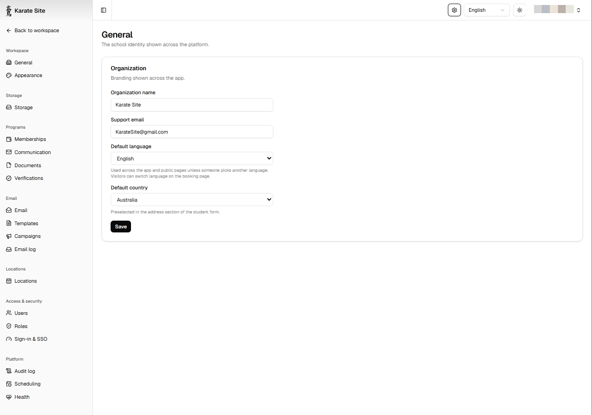

### Appearance & branding

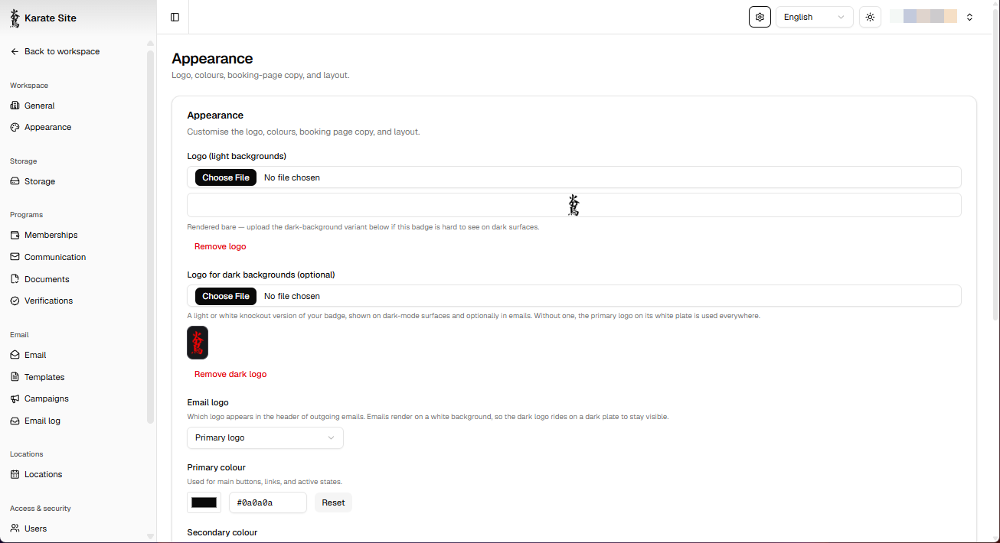

### Documents

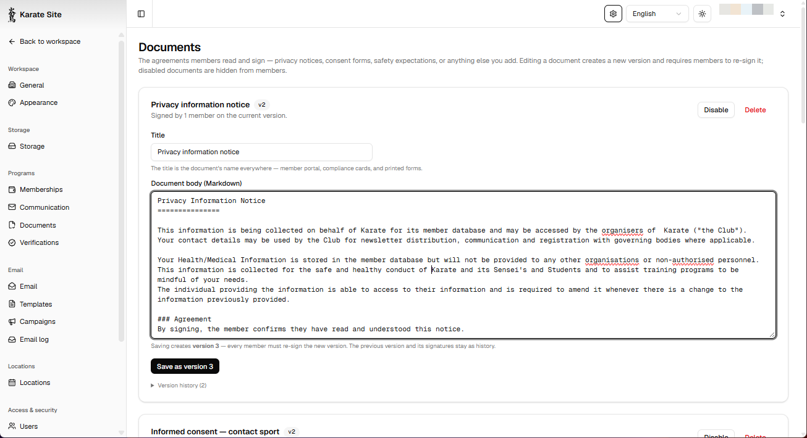
